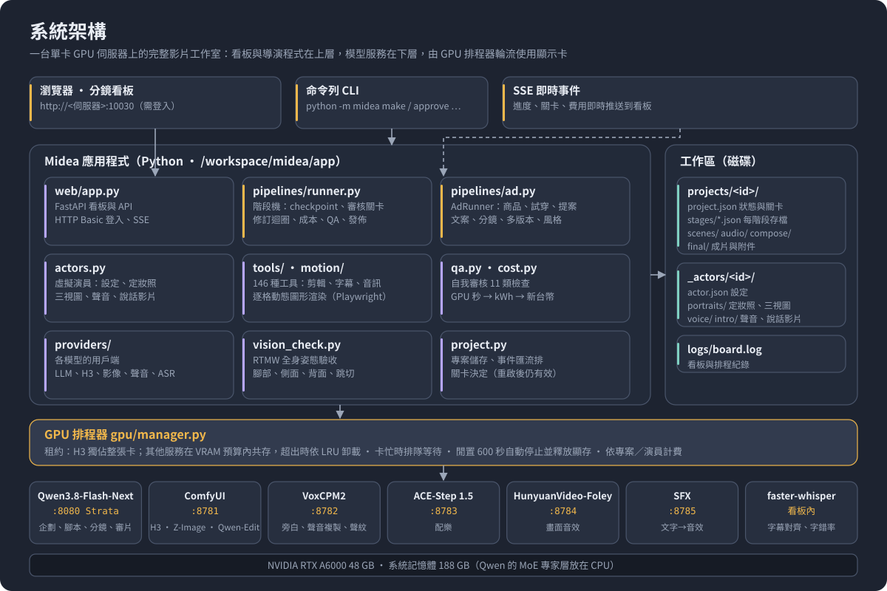
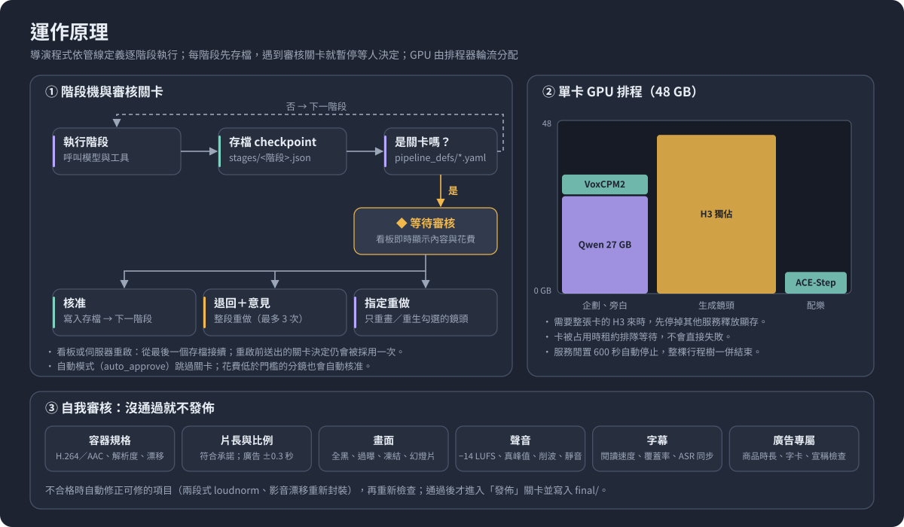
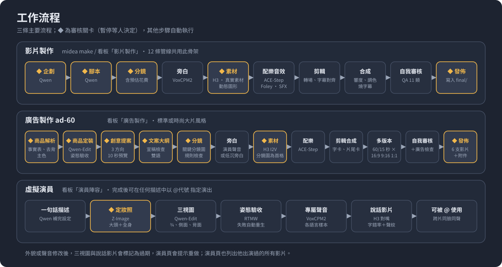
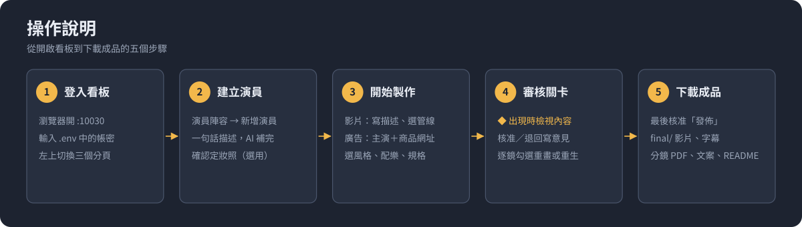

# Midea — 本地 GPU AI 影片工作室

參考 [OpenMontage](https://github.com/calesthio/openmontage) 的「管線＋工具＋審核關卡」架構，Midea 完全以**本地模型**運作，並內建一個**程式化的導演（Runner）**，不需要外部 AI 編碼助手來編排：

| 角色 | 模型 | 在 Midea 中負責 |
|---|---|---|
| 編劇／導演／審片 | **Qwen3.8-Flash-Next**（llama-server，OpenAI 相容） | 企劃、腳本、分鏡、素材排序、參考影片解構、抽影格視覺審核、翻譯 |
| 影片生成 | **MiniMax H3**（ComfyUI，FL2VA pruned INT8） | T2V／I2V（末幀接首幀保持連續性）／R2V（參考圖一致性），原生音訊 |
| 旁白 | **VoxCPM2** | 48 kHz 旁白、聲音設計（用文字描述聲音）、聲音複製（需取得授權） |
| 背景音樂 | **ACE-Step 1.5**（MIT 授權，turbo 版 < 4 GB VRAM） | 10 秒～10 分鐘配樂，可選人聲歌詞 |
| 畫面音效 | **HunyuanVideo-Foley** | 依畫面內容生成同步的 Foley 音效與環境音（48 kHz） |
| 文字音效 | **Stable Audio Open 1.0** | 轉場 whoosh、UI 音、環境音 |
| 字幕對齊 | faster-whisper large-v3 | 字級時間戳記、參考影片轉錄 |
| 演員定妝照 | **Z-Image-Turbo**（Apache-2.0，與 H3 共用 ComfyUI） | 虛擬演員的正面大頭照與正面全身定裝 |
| 影像編輯 | **Qwen-Image-Edit-2511**（Apache-2.0，4 步 Lightning LoRA） | 三視圖、商品試穿、廣告關鍵分鏡合成 |

> 音樂與音效模型是依需求補上的：ACE-Step 1.5 負責配樂，HunyuanVideo-Foley（影片→音效）與 Stable Audio Open（文字→音效）互補。三者都能在 24 GB 卡上跟其他模型輪流使用。

## 目錄

[系統架構](#系統架構) · [運作原理](#運作原理) · [工作流程](#工作流程) · [操作說明](#操作說明) · [設計系統](#設計系統) · [四大功能](#四大功能) · [虛擬演員](#虛擬演員-指定演出) · [60 秒廣告](#60-秒廣告ad-60) · [快速開始](#快速開始) · [程式結構](#程式結構)

## 系統架構



Midea 是一台單卡 GPU 伺服器上的完整影片工作室，分成四層：

- **使用者介面**：
  - 瀏覽器開的**分鏡看板**：FastAPI 提供，透過 SSE 即時推送進度與關卡。
  - **命令列**：`python -m midea …`。
  - 兩者操作的是同一批專案。
- **導演程式**：`pipelines/runner.py` 依 `pipeline_defs/*.yaml` 的階段清單逐步呼叫模型與工具。
  - 廣告用 `AdRunner`，虛擬演員用 `actors.py`。
  - 剪輯、字幕、響度、動態圖形由 146 種工具完成，最後由 `qa.py` 做自我審核。
- **GPU 排程器**：`gpu/manager.py` 決定哪個模型服務此刻可以用顯示卡，並按專案或演員計算 GPU 時間與電費。
- **模型服務**：各自是一個本機 HTTP 服務。
  - ComfyUI（:8781）同時載入 MiniMax H3、Z-Image-Turbo 與 Qwen-Image-Edit。
  - Qwen 由 Strata 提供（:8080），需要時才啟動。

所有狀態都存在工作區的檔案裡，因此看板重啟、斷線都不會遺失進度：
- `projects/<id>/`：每個階段的存檔、素材、成片。
- `_actors/<id>/`：演員設定、定妝照、聲音、說話影片。

## 運作原理



1. **階段機**：
   - 每個階段做完就把結果寫成 `stages/<階段>.json`。
   - 下一階段只讀前一階段的存檔，所以任何時候中斷都能從最後一個存檔接續。
   - 從看板「倒回」某一階段，就會從那裡重新往下做。
2. **審核關卡**：管線定義中列為關卡的階段，做完後會暫停在「等待審核」。你在看板上有三種回應：
   - **核准**：往下做。
   - **退回並寫意見**：意見會交給 Qwen，整段重做，最多 3 次。
   - **指定重做**：只重畫某幾張分鏡圖、只重生某幾個鏡頭、只重做某張試穿照，其他保留不動。
   - 看板重啟前送出的決定，重啟後仍會被採用一次。
3. **規劃與檢查分工**：Qwen 負責寫企劃、腳本、文案與分鏡，程式負責檢查它寫的東西：
   - 分鏡的鏡數、秒數、段落是否齊全。
   - 台詞與字卡是否都放進鏡頭。
   - 廣告宣稱能否對回商品事實表。
   - 不合格就附上問題自動重寫一次。
   - 模型回覆被截斷時會加大長度重問，不會接受殘缺的結果。
4. **單卡排程**：
   - 需要整張卡的 H3 來時，先停掉其他服務釋放顯存。
   - 其他服務在 VRAM 預算內共存，超出時依最久未使用者卸載。
   - 卡被占用時租約排隊等待；服務閒置 600 秒自動停止。
5. **自我審核**：成片要通過容器規格、片長、畫面、聲音、字幕（與 ASR 比對同步誤差）等檢查才會進入「發佈」。
   - 響度或影音長度漂移不合格時，會自動修正後重驗。
   - 演員照片另外用 RTMW 全身姿態驗收：看得到腳、真正的側面與背面。
   - 說話影片用 Whisper 字錯率、ECAPA 聲紋與跳切偵測驗收。

## 工作流程



- **影片製作**：企劃 ◆ → 腳本 ◆ → 分鏡（含預估花費）◆ → 旁白 → 素材 ◆ → 配樂音效 → 剪輯 → 合成 → 自我審核 → 發佈 ◆。
  - 旁白先於畫面：先錄好旁白，再依實際長度調整每一鏡的秒數。
  - 12 條管線都用這個骨架，只是階段與風格預設不同，例如紀錄片只用真實素材，動畫解說以動態圖形為主。
- **廣告製作（ad-60）**：商品解析、試穿、創意提案、文案、分鏡都是關卡。生成時以核准的分鏡圖當 H3 的第一格畫面，最後輸出 60 秒和 15 秒、三種比例共 6 支。詳見 [60 秒廣告](#60-秒廣告ad-60)。
- **虛擬演員**：
  1. 一句話描述 → Qwen 補完設定。
  2. 定妝照（等你確認）→ 三視圖 → 姿態驗收。
  3. 專屬聲音 → 說話影片。
  4. 完成後在任何描述中寫 `@代號` 就能指定他演出。

## 操作說明



**1. 登入看板**
- 部署在共用伺服器時，看板網址是 `http://<伺服器>:10030`，使用 HTTP Basic 登入。
  - 帳密寫在伺服器的 `app/.env`：`MIDEA_BOARD_USER`、`MIDEA_BOARD_PASSWORD`。
  - 沒設密碼時，看板會拒絕在對外位址啟動。
- 本機開發用 `make serve`，看板在 http://127.0.0.1:7788，不需登入。
- 左上角三個分頁：**影片製作**、**演員陣容**、**廣告製作**。

**2. 建立演員**（要讓固定人物演出時）
1. 演員陣容 →「新增演員」→ 寫一句描述（例如「32 歲台灣女記者，俐落短髮」）→ AI 補完設定，可再手動修改。
2. 「產生定妝照」→ 確認正面大頭照與全身照。之後會自動產生三視圖、聲音與一段自我介紹的說話影片。
3. 若用真人照片或聲音建立演員，必須勾選授權聲明並填寫授權來源。

**3. 開始製作**
- **影片**：在影片製作頁寫描述，用 `@代號` 指定演員，選管線、長度與比例後送出。
- **廣告**：在廣告製作頁依序設定：
  - 主演與搭檔、商品網址。
  - 台詞語言與字幕語言、輸出規格。
  - **風格**：
    - 「標準商業廣告」：對白加賣點示範。
    - 「時尚大片」：無對白、少量低沉旁白、壯闊場景、商品晚出場。
  - **配樂**：依風格決定，或指定古典、鄉村。

**4. 審核關卡**
- 看板出現 ◆ 時，流程會停下來等你。檢視內容與預估花費後：
  - **核准**：往下做。
  - **退回**：寫下具體意見（例如「旁白不要描述畫面」）。
  - **指定重做**：勾選要重畫的分鏡圖或要重生的鏡頭，並修改描述。
- 不開看板時，也可以用 CLI 核准：`python -m midea approve <專案 id> <關卡>`。

**5. 下載成品**
- 自我審核通過後，最後核准「發佈」，成品寫入專案的 `final/`：
  - 影片、字幕（srt／ass）、縮圖。
  - 廣告另附分鏡表 PDF、文案稿（每條宣稱附出處）、風格意象板。
  - 一份列出模型、演員授權、素材出處與成本的 `README.md`。
- 廣告成品以「品牌＋主標」命名，例如 `iSunTVMall A pause before departure_60s_9x16.mp4`。

**常見狀況**
- **看板顯示等待審核，但沒有動作**：流程停在關卡上，核准或退回即可。
- **鏡頭生成很慢**：H3 每個鏡頭約 4–6 分鐘，期間整張卡被占用；排隊中的工作會等前一個做完。
- **成品沒有出現在 final/**：查看自我審核報告。標為失敗的項目要先修正，或退回對應階段重做。
- **想從某一步重來**：在專案頁「倒回」該階段，之後的階段會重新執行。

## 四大功能

1. **一句話成片**：`midea make "製作一支 60 秒解釋神經網路的動畫"` → 企劃 → 腳本 → 分鏡 → 旁白 → 素材 → 配樂音效 → 剪輯 → 響度與字幕 → 自我審核 → 成片。
2. **全真實素材紀錄片**：`--real-only` 會鎖定只用 Archive.org、NASA、Wikimedia Commons、Pexels、Pixabay 的素材，依授權過濾，由 Qwen 依相關性與年代排序，再加上 Ken Burns、去交錯、膠片質感，片尾自動列出出處。
3. **參考影片結構改編**：`--ref <Shorts/Reels/TikTok 連結>` 以 yt-dlp 下載，接著做切點偵測、抽關鍵影格、ASR，交給 Qwen 視覺分析，抽出節奏、鉤子、分段、字幕樣式這些「模板」，再套到新主題上。
4. **動態圖形與角色動畫**：內建逐格決定性渲染引擎（Playwright + SVG／Canvas／three.js → FFmpeg），提供動態文字排版、圖表、儀表 KPI、神經網路圖、時間軸、路線地圖、**SVG 骨架角色**（idle／wave／walk／talk／point／jump，依旁白音量自動對嘴，可匯入自訂骨架），以及 **3D 產品轉台**（可載入 .glb）。

## 虛擬演員（@ 指定演出）

在看板左上角切到「演員陣容」建立擬真虛擬演員，製作影片時在描述中輸入 `@` 就能指定誰演出：

- **完整設定**：姓名、@代號、年齡、性別、國籍、職業、外貌（族裔外觀、身高、體型、五官、髮型、眼睛、膚色、辨識特徵）、預設造型、個性、表演風格、背景故事、聲音。只要寫一句話（例如「32 歲台灣女記者，俐落短髮」），Qwen 就會補完整份設定，之後都能手動修改。
- **定妝照與三視圖**：
  - Z-Image-Turbo 以同一個 seed 生成正面大頭照與正面全身照（含鞋），等你確認。
  - 確認後，Qwen-Image-Edit 以這兩張為準，展開四分之三側臉、正側面全身、背面全身。
  - 每張都經 RTMW 全身姿態驗收（看得到腳、真正的側面與背面），不合格會自動重生。
  - 每張也都可以單獨重生、設為主照；整組重生則會換一張臉。
- **專屬聲音與說話影片**：
  - VoxCPM2 依年齡、性別與聲音描述設計出聲音並錄一段試音，各語言分開保存。
  - 之後這位演員的每一句台詞都以這段試音做聲音複製，所以每支影片的聲音都一致。
  - 演員頁播放的是一段 H3 對嘴的自我介紹影片，經 Whisper 字錯率、ECAPA 聲紋相似度與跳切偵測驗收。
- **跨鏡頭、跨影片保持同一張臉**：分鏡中出現演員的鏡頭會自動改用 MiniMax H3 Ref2VA，並附上主照和全身定裝當參考圖（單鏡最多 4 位演員、9 張圖）。Qwen 會依演員的個性安排動作與台詞，`speaker` 欄位決定每一段由誰以自己的聲音說。
- **演出作品**：演員頁會列出這位演員出現過的每支影片，包括角色（主演或配音）、出場鏡頭縮圖、台詞段數與製作狀態。點一下就能打開該專案。
- **真人授權**：可以上傳真人照片或聲音樣本來建立演員，但上傳前必須勾選「已取得本人書面授權」並填寫授權來源。授權紀錄會保存在演員資料中，也會列在成片 README 的演員清單裡。
- CLI：`midea actors new "一句話描述"`、`midea actors list`、`midea actors show @mei`，以及 `midea make "@mei 走訪台南老街的一天" --pipeline cinematic`。

> 一般影片中的台詞預設以畫外音呈現；要讓演員在畫面中親口說，需開啟實驗性的 `lipsync`（把台詞音檔當成 H3 的 `<Audio 1>` 參考）。

## 60 秒廣告（`ad-60`）

在看板切到「廣告製作」，選主演（穿戴或使用商品的人）、搭檔，填入商品網址，就會依序產出下列內容。標 ◆ 的步驟會停下來等你核准：

1. **商品解析 ◆**：讀取商品頁的結構化資料、商品名稱、描述與圖片，整理成「商品事實表」。
   - 每條事實都附上頁面原文，並標示是否已在頁面上核對到。
   - 頁面上的示範價、非售價、樣品或不可訂購等說明，一律不會進入廣告。
   - 商品圖會自動去背，並抽出主色。
2. **商品定裝 ◆**：如果商品是服飾或配件，會用 Qwen-Image-Edit 讓主演穿上它，產出正面全身、大頭照、側面全身三張照片，並逐張做姿態驗收。版型或穿法不對，可以勾選後寫下說明重畫。
3. **創意提案 ◆**：提出三個創意方向。每個方向都有概念、slogan、5 色色票、光線、配樂、4 張風格意象圖，以及一段 **10 秒動態預覽**（兩個 H3 鏡頭加配樂草稿）。選定方向後才往下做。
4. **廣告文案與腳本大綱 ◆**：包含主標、副標、CTA、字卡、台詞、社群貼文，以及六段式大綱（鉤子、痛點、商品登場、賣點示範、情感、CTA）。**宣稱檢查**會擋下以下內容：
   - 沒有對應商品事實的宣稱
   - 療效或絕對化用語
   - 頁面上沒有的數字
   - 不可使用的價格
   - 樣品、不可訂購之類的字樣
5. **鏡頭語言與關鍵分鏡 ◆**：列出每一鏡的景別、角度、運鏡、焦段、光線、色調、轉場、台詞與字卡。每鏡都用 Qwen-Image-Edit 把演員和商品合成成一張分鏡圖，可以逐張改描述重畫。
6. **生成**：H3 以核准的分鏡圖當第一格畫面生成影片，所以成片和分鏡一致。
   - 台詞用演員聲音的複製版本，可以換語言，例如英文。
   - 片尾是商品定格畫面，包含商品去背圖、主標、CTA、logo 與網址，配色依選定方向。
   - 字幕可以做成雙語（例如英文加繁中），字卡以上方大字的方式燒進畫面。
7. **多版本輸出**：60 秒和 15 秒，各輸出 16:9、9:16、1:1，共 6 支。
   - **1:1**：依人物位置從 16:9 裁切。
   - **9:16**：只有在裁切後仍保住人物、且原始畫素至少 480px 時才裁切，否則重畫 9:16 分鏡並重新生成。H3 以 0.6MP（1024×576）生成時，9:16 裁切只剩 324px，所以實務上會全部重新生成。
   - **15 秒版**：依序取鉤子、商品登場、最強賣點、片尾，配樂另外生成，只保留放得下的完整台詞。
8. **風格**：同一條管線可選兩種拍法。
   - **標準商業廣告**：演員對白，依六段式大綱示範賣點，片尾是商品定格卡。
   - **時尚大片**（`style: fashion`）：參考奢侈品時尚大片的套路。
     - **場景與人物**：選一個與商品日常用途無關的壯闊場景；人物從容、停頓、回頭。
     - **鏡頭**：只用特寫與大遠景，穿插自然意象鏡頭，加入廣角誇張透視與超現實的商品擺放。
     - **商品**：約在 40% 處才第一次特寫，結尾用商品微距。
     - **聲音**：全片無對白，只有最多 6 句的低沉旁白，配樂限古典或鄉村。
     - **畫面質感**：低飽和加顆粒調色、寬字距字卡、極簡字標片尾。
9. **自我審核與交付**：自動檢查以下項目，最後交付 6 支影片、分鏡表 PDF、文案稿（每條宣稱附出處）、風格意象板。
   - 片長 60.0±0.3 秒、15.0±0.3 秒
   - 響度
   - 雙語字幕的閱讀速度
   - 字卡與文案是否一致
   - 商品出現的時間比例（標準 35% 以上；時尚大片刻意晚出場，門檻 25%）
   - 宣稱檢查

## 特色

- **即時分鏡看板（Approval Gates）**：`midea serve` → 本機 http://127.0.0.1:7788，伺服器上 `http://<伺服器>:10030`（需登入）。看板即時呈現企劃、腳本、分鏡卡、生成素材、旁白試聽、預估與實際花費（GPU 秒 → kWh → 新台幣），並在**企劃／腳本／分鏡（含預估花費）／素材／發佈**這幾個節點暫停。可以逐鏡勾選重做、改提示詞、換一個真實素材候選，也能直接編修 JSON 後再核准。
- **單卡 GPU 排程**：針對 24–48 GB 單卡設計。`h3` 會獨佔整張卡；其他服務在 VRAM 預算內共存，超出時依 LRU 卸載，閒置一段時間自動釋放。Qwen 的 MoE 專家層放在 CPU（`--n-cpu-moe`）。
- **嚴謹自我審核**：12 條管線、146 種工具。輸出前一定會檢查以下項目，失敗的成片不會發佈：

  | 檢查 | 內容 |
  |---|---|
  | container | ffprobe：H.264／AAC、yuv420p、48 kHz 立體聲、解析度、fps、影音長度漂移 |
  | delivery | 長度符合承諾（±5% 警告、±10% 失敗）、比例、有字幕 |
  | frames | 4 個位置抽影格：全黑、過曝、空白畫面 |
  | black／freeze／slideshow | 節目內黑畫面比例、凍結畫面、靜態（幻燈片）風險 |
  | loudness／clipping／dead_air | EBU R128（預設 −14 LUFS、TP ≤ −1 dBTP）、削波、> 2 秒靜音 |
  | subtitles | 每秒字數、每行字數、重疊、旁白覆蓋率、與 ASR 字級時間戳的同步誤差 |
  | vision | Qwen 檢視抽出的影格是否符合分鏡（崩臉、亂碼文字、浮水印） |

  響度不合格時會自動以兩段式 loudnorm 修正後重驗。

## 製作管線

12 條影片管線加上廣告管線 `ad-60`：`animated-explainer` 動畫解說 · `hybrid` 一鍵混合 · `cinematic` 電影感 · `shorts-factory` 直式短影音 · `documentary-montage` 真實素材紀錄片 · `archival-history` 歷史檔案 · `reference-remix` 參考改編 · `motion-graphics` 動態圖形 · `character-animation` SVG 角色 · `product-3d` 3D 產品 · `clip-factory` 長片切短片 · `localization-dub` 在地化配音

## 快速開始

```bash
make setup                 # 核心（不需要 GPU）
make demo                  # mock 模式端到端跑一支片，確認環境
make setup-gpu             # GPU 機器：安裝並下載所有模型（請先讀 scripts/install_models.sh）
# 依 workflows/README.md 從 ComfyUI 匯出 H3 的 API workflow
python -m midea doctor     # 檢查 ffmpeg 濾鏡、字型、GPU、各模型服務
make serve                 # 開看板
```

CLI 範例：

```bash
python -m midea make "製作一支 60 秒解釋神經網路的動畫"
python -m midea make "1969 登月" --real-only --duration 90
python -m midea make "三個咖啡沖煮技巧" --ref https://www.youtube.com/shorts/XXXX
python -m midea make "小明介紹垃圾分類" --pipeline character-animation --voice "(活潑的小男孩聲音)"
python -m midea make "把這集 Podcast 剪成短片" --media ep12.mp4 --pipeline clip-factory
python -m midea approve <project-id> scene_plan          # 不開看板時從 CLI 核准
python -m midea services status                          # 查看 VRAM 配置
```

## 硬體建議（單卡 24–48 GB）

- **48 GB**（RTX 6000 Ada／A6000／L40S）：預設設定，H3 1344×768、30 steps。
- **24 GB**（RTX 4090／5090）：在 `config.yaml` 設 `gpu.vram_gb: 24`，H3 改為 1024×576、24 steps，每鏡 ≤ 8 秒。成本估算會自動乘 1.8 倍時間。
- **系統記憶體 ≥ 128 GB**：Qwen3.8-Flash-Next 4-bit 約需 96–114 GB（RAM + VRAM），H3 的 offload 約需 64 GB 以上。記憶體不足時可以在 `services.qwen` 把 `base_url` 指到另一台機器的 OpenAI 相容端點。

## 設計系統

網站與介面的設計語言、token 與元件放在 [docs/design-system/](docs/design-system/README.md)。規劃或開發頁面時先讀它；規則寫在 [CLAUDE.md](CLAUDE.md)。

## 公開網站 midea.cafeca.io（`midea site`）

觀眾端的網站與分鏡看板分開跑：`midea site`（預設 127.0.0.1:10030，前面接 HTTPS 反向代理；伺服器上 https://midea.cafeca.io 已接到這個 port）。它只讀取已發佈的專案（`final/` 裡的成片與縮圖）和已通過驗收的演員自我介紹，不碰製作流程。

- **頁面**：首頁（A3 拼貼）、直播 `/live`、影片 `/watch/{id}`、節目表 `/schedule`，全部用 `docs/design-system/` 的 token 與元件。
- **官方頻道**：每週一 09:00 排好下一週（每天 48 個 30 分鐘時段，20:00–24:00 是主打）；週六 21:30 是「觀眾決定」時段，週一到週四投票。主題每 6 小時重新歸納；最多人看只算完整看完的次數，每小時更新。
- **觀眾互動（第一期）**：影片反應（喜歡／想看更多這類／不感興趣，免登入）、收藏、分享、直播即時反應與「N 人正在看」、時段結束的「下週還想看嗎」、觀眾決定投票。反應、投票與時段投票直接影響主題、推薦與下週排程，畫面上用固定寫法標出原因（「觀眾投票選出」「觀眾想再看」「觀眾最有反應的片段」）。直播反應的峰值會寫進專案的 `audience/highlights.json`，供剪 15 秒版參考。
- **登入**：只用 CAFECA（通行金鑰，免密碼）。後端自己驗 EIP-712 簽章（ERC-1271 `isValidSignature`），帳戶地址是觀眾的 id；投票不要求 KYC 等級，但結果依等級分開統計。登入只能在設定的網域（`site.origin`）上完成。
- **資料**：SQLite（`<workspace>/_site/site.db`）、節目表與主題 JSON；API 在 `/api/public/v1`。完整規劃見專案文件「觀眾反饋與互動功能規劃」。

## 伺服器部署

共用 GPU 伺服器（cafeca-aich-001）的部署方式、port 配置、接 Strata Qwen 端點與 GPU 共用策略見 [docs/DEPLOY.md](docs/DEPLOY.md)；一鍵安裝模型堆疊：`MIDEA_STACK=/workspace/midea bash scripts/deploy_server.sh`。

## 授權注意

- **MiniMax H3 Community License** 不涵蓋美國、歐盟、英國、南韓的使用與輸出；年營收 ≥ 2,000 萬美元的組織商用需要另外取得授權。成片 README 會自動附上標示。
- 真實素材依各來源授權，片尾與 `final/README.md` 會列出出處。Archive.org 標示為 public domain 的素材仍建議人工確認。
- VoxCPM2 聲音複製只能用於已取得授權的聲音；以真人照片或聲音建立演員時，系統會強制要求勾選授權聲明並保存紀錄。
- Z-Image-Turbo 為 Apache-2.0 授權。
- 視覺風格（`slate` 調色盤：石板藍底、琥珀色重點、薰衣草紫次要色）參考 `docs/style-reference.png`。

## 程式結構

```
midea/
  config.py  gpu/manager.py          設定、單卡 VRAM 排程（獨佔／共存／LRU／閒置卸載／排隊）
  providers/                         llm(Qwen) video_h3(ComfyUI) image_zimage image_edit(Qwen-Edit)
                                     audio(VoxCPM2/ACE-Step/Foley/SFX) product(商品頁解析) stock asr reference + mock
  servers/                           VoxCPM2（含聲紋 /similarity）、Stable Audio、Foley 的常駐 HTTP 服務
  tools/                             146 種工具：video audio subtitles analysis generation motion_engine
  motion/templates/                  15 個逐格渲染範本（SVG／Canvas／three.js），含廣告片尾卡
  pipelines/runner.py                階段機：checkpoint、關卡、修訂迴圈、成本、QA、發佈
  pipelines/ad.py                    廣告管線 AdRunner 與廣告風格（標準／時尚大片）
  actors.py  vision_check.py         虛擬演員（設定、定妝照、三視圖、聲音、說話影片）與姿態驗收
  qa.py  cost.py  project.py         自我審核、成本模型、專案儲存／事件／關卡決定
  web/                               FastAPI + SSE 分鏡看板（HTTP Basic 登入）
  site/                              公開網站：catalog（已發佈作品）programming（節目表、主題、排行、投票）
                                     live（即時反應、同時在看）cafeca（登入驗簽）store（SQLite）static（頁面）
pipeline_defs/*.yaml                 13 條管線定義（階段、關卡、風格預設）
workflows/                           MiniMax H3 ComfyUI API workflow（自行匯出）
scripts/gen_readme_diagrams.py       產生本文件的 SVG 圖（docs/images/）
scripts/gen_tokens_css.py            由 docs/design-system/tokens.json 產生 tokens.css
docs/design-system/                  網站設計系統：設計語言、版面、元件規劃、token、元件
```

在沒有 GPU 的環境可以用 `MIDEA_MODE=mock`：Qwen 改由決定性規劃器代答，影像、聲音、音樂改用程式產生的佔位素材，其餘剪輯、字幕、動態圖形、QA、看板都會真實執行。
